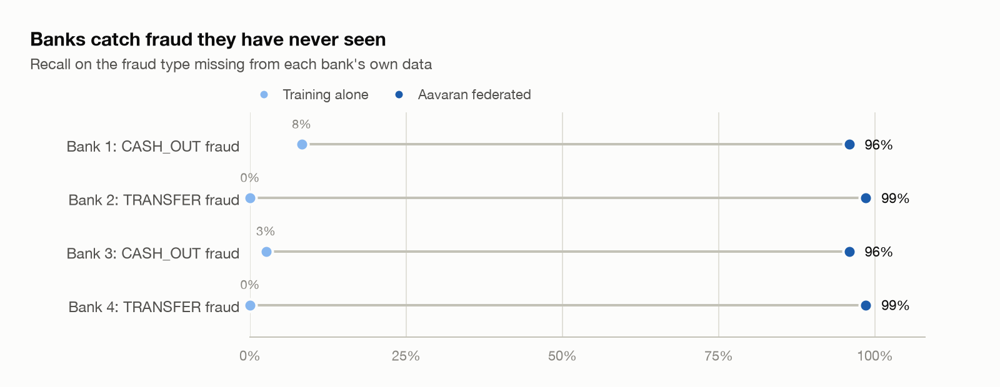
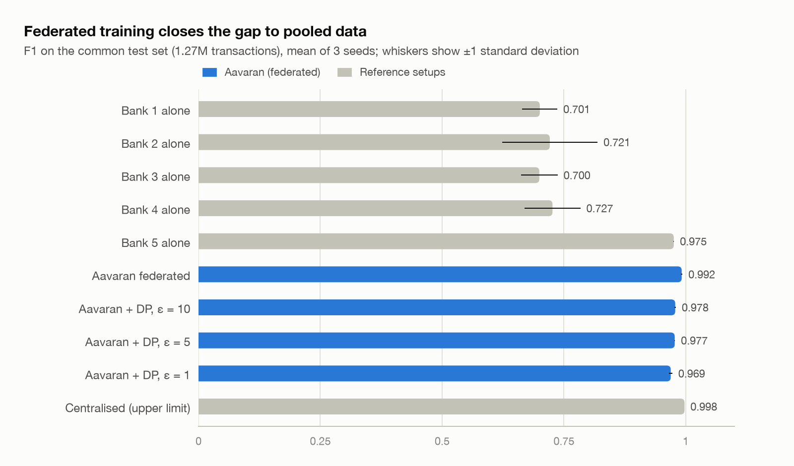
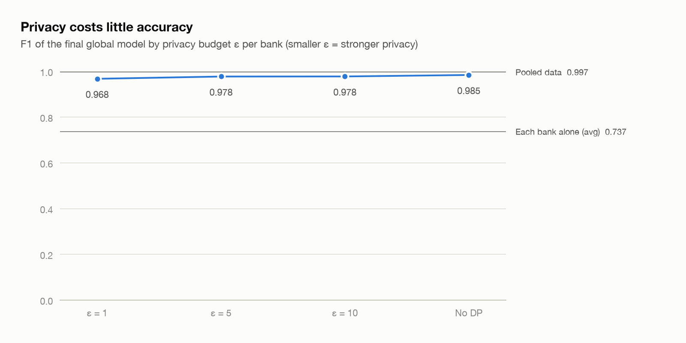
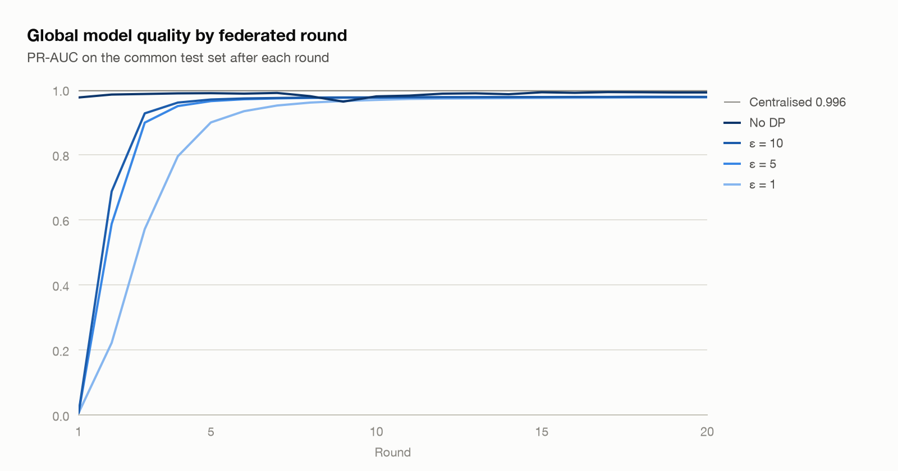

# Aavaran: Privacy-Preserving Federated Fraud Detection

## Problem Statement

Banks lose billions every year to payment fraud. Fraud gangs reuse the same tricks across many banks, but each bank can only learn from its own customers' transactions. Privacy laws (such as India's DPDP Act and Europe's GDPR), banking secrecy and competition stop banks from pooling customer data.

The result: every bank has to learn about each new fraud pattern separately, on its own, and usually only after its own customers have already lost money. Fraudsters take advantage of this by moving the same scheme from one bank to the next.

**Aavaran lets several banks train one shared fraud detection model together without any bank ever sharing a single customer record.**

## A Simple Example

A fraud gang buys a batch of stolen card details, from cards issued by many different banks. They use the same playbook on every card:

1. Make two or three tiny "test" payments of ₹1 to ₹10 to check the card works.
2. Within minutes, make one large purchase at a newly registered online merchant, often late at night.

The cards are different, but the **behaviour pattern is the same**.

- **Without Aavaran:** Bank A gets hit first, and after enough losses its model learns to flag this pattern. Banks B, C and D have never seen it, so their models let it through, and their customers lose money too. Bank A cannot share its data with them.
- **With Aavaran:** Bank A's model learns the pattern locally. Only the model's learned weights (numbers, not customer data) are sent to a central aggregator, which combines them with the updates from the other banks. The improved global model goes back to every bank. Now Banks B, C and D can catch the pattern before it hits them, and no customer data has left Bank A.

## How It Works (The Big Idea)

Aavaran uses **federated learning**:

1. Each bank (client) keeps its transaction data on its own servers.
2. Each bank trains a copy of the fraud model on its own data.
3. Each bank sends only its model updates (weights) to a central server.
4. The server combines the updates using **FedAvg** (Federated Averaging) to make a better global model.
5. The global model is sent back to all banks, and the cycle repeats for several rounds.
6. **Differential privacy** adds carefully controlled noise to the updates, so nobody, not even the server, can work backwards to individual customers.

## Results

Measured on the common held-out test set: 1,272,524 transactions, 1,642 of them fraud. The full table is in [results/comparison.md](results/comparison.md).

| Setup | F1 | PR-AUC |
| --- | --- | --- |
| Banks 1 to 4, each training alone | 0.660 to 0.701 | 0.554 to 0.735 |
| Bank 5 alone (saw a little of both fraud types) | 0.986 | 0.994 |
| Average of the 5 banks training alone | 0.74 | 0.73 |
| **Aavaran federated** | **0.985** | **0.992** |
| Aavaran + differential privacy, ε = 10 | 0.978 | 0.978 |
| Aavaran + differential privacy, ε = 5 | 0.978 | 0.978 |
| Aavaran + differential privacy, ε = 1 | 0.968 | 0.976 |
| Centralised: all data pooled (not allowed in real life) | 0.997 | 0.996 |

The four banks that each lack one fraud type score 0.66 to 0.70 alone, and federated training lifts them to 0.985. Bank 5, which sees both fraud types, already scores 0.986 alone.

- **Fraud a bank has never seen:** training alone, Banks 1 to 4 catch only 0 to 8% of the fraud type missing from their own data. The federated model catches 96 to 99% of it, and no bank shared a single record.
- **Close to pooled data:** federated F1 is 0.985, against 0.997 when all data is pooled.
- **Privacy costs little:** with differential privacy at ε = 1 per bank, F1 is still 0.968. From ε = 5 upwards, accuracy is limited by gradient clipping rather than noise, so ε = 5 and ε = 10 score the same.
- **Real time:** at a steady 2,000 transactions per second, median end-to-end latency (producer to Kafka to scored) is 16 ms, with p95 at 62 ms. At peak, one scorer process handles about 130,000 transactions per second. Both were measured on an Apple M2 Mac with 8 GB RAM ([results/streaming.json](results/streaming.json), [results/streaming_peak.json](results/streaming_peak.json)).

<picture>
  <source media="(prefers-color-scheme: dark)" srcset="results/charts/unseen_fraud_recall-dark.png">
  
</picture>

<picture>
  <source media="(prefers-color-scheme: dark)" srcset="results/charts/f1_by_setup-dark.png">
  
</picture>

<picture>
  <source media="(prefers-color-scheme: dark)" srcset="results/charts/privacy_tradeoff-dark.png">
  
</picture>

<picture>
  <source media="(prefers-color-scheme: dark)" srcset="results/charts/rounds_pr_auc-dark.png">
  
</picture>

## Design Decisions

- **Sender-side features only.** A bank sees its own customer's balances, not the balance of a receiving account at another bank. PaySim's destination balances are also a known simulator artefact for fraud rows.
- **A strongly non-IID split.** With a softer split, where each bank got 2 to 3% of the other fraud type, every bank learned both patterns on its own and isolated F1 was already about 0.99 ([results/baseline_soft_split_all_features.json](results/baseline_soft_split_all_features.json)). A few dozen examples of a PaySim fraud pattern are enough to learn it. What matters is whether a bank has seen the pattern at all, which is exactly the real-world gap Aavaran closes.
- **The same training budget for every setup:** 20 passes over the data. Isolated and centralised models train for 20 epochs; federated training runs 20 rounds of 1 local epoch.
- **Privacy accounting across all rounds.** Each bank's noise level is set once, so that its whole 20-round run spends exactly its ε (δ = 10⁻⁷, clipping norm 1.0, Poisson-sampled batches of 4,096), tracked with Opacus's RDP accountant.
- **Known limitation, client drift:** without DP, the global model's F1 swings between 0.87 and 0.99 from round to round, because banks with opposite fraud types pull the model in different directions. PR-AUC stays between 0.96 and 0.99. FedProx (Stage 10) is designed for this.
- **Simulation caveat:** the server holds the common test set only to measure results. In a real deployment, each bank would evaluate locally.

## Technology Stack

| Layer | Technology | Purpose |
| --- | --- | --- |
| Language | Python 3.10+ | Core development |
| Data processing | Pandas, NumPy, scikit-learn | Cleaning, splitting, scaling, metrics |
| Model | PyTorch | Neural network for fraud classification |
| Federated learning | Flower (flwr) | Client and server orchestration, FedAvg |
| Privacy | Opacus | Differential privacy during local training |
| Imbalance handling | Class-weighted loss (PyTorch) | Fraud is rare, so the classes are heavily imbalanced |
| Dashboard | Streamlit, Plotly | Visualising training rounds and results |
| Deployment | Docker, Docker Compose | Local Kafka broker now; each bank as its own container in phase 2 |
| Streaming | Apache Kafka | Real-time transaction scoring |
| Explanations (phase 2) | SHAP + an LLM | Plain-English reasons for each fraud alert |

**Dataset:** PaySim synthetic mobile money dataset (Kaggle), about 6.3 million transactions with fraud labels. IEEE-CIS Fraud Detection is an optional alternative.

## Step-by-Step Implementation

### Step 1: Data Preparation

- Download PaySim and load it with Pandas.
- Engineer features from the **sender's side** of each transaction only: amount, the sender's balance before and after, money that does not add up on the sender's books, an "account drained" flag, hour of day and transaction type. A bank cannot see the balance of a receiving account held at another bank, so destination balances are left out.
- Scale numeric features with means and standard deviations built from per-bank totals (count, sum, sum of squares), so no rows are pooled even for preprocessing.
- Split the data into **5 simulated banks**, using a **non-IID split**: Banks 1 and 3 only ever see TRANSFER fraud, Banks 2 and 4 only ever see CASH\_OUT fraud, and Bank 5 is a small bank that sees a little of both. This is what makes collaboration valuable.
- Keep a common held-out test set (20%, 1.27 million transactions) for fair evaluation.

### Step 2: Baseline Model (Single Bank)

- Build a small feed-forward neural network in PyTorch (for example 3 layers with ReLU and dropout, and a sigmoid output).
- Handle class imbalance with a weighted loss.
- Train on one bank's data alone.
- Evaluate with **precision, recall, F1-score and PR-AUC**. Accuracy alone is misleading because fraud is under 1% of transactions.

### Step 3: Federated Learning with Flower

- Wrap the training code in a Flower `ClientApp` (Flower 1.42 Message API: `@app.train()` and `@app.evaluate()`).
- Create a Flower `ServerApp` using the **FedAvg** strategy.
- Run 5 clients (one per bank) and train for about 20 rounds.
- Log each round's global model metrics.

### Step 4: Differential Privacy with Opacus

- Attach Opacus's `PrivacyEngine` to each client's optimiser.
- Train at several privacy levels (epsilon values such as 1, 5 and 10).
- Record the **privacy vs performance trade-off**.

### Step 5: Comparison Experiments

Compare three setups on the same test set:

1. **Isolated:** each bank trains alone.
2. **Federated:** Aavaran, with and without differential privacy.
3. **Centralised:** all data pooled (the theoretical upper limit, not allowed in real life).

The goal is to show that federated performance gets close to centralised performance and clearly beats isolated banks, especially on fraud types a bank has rarely seen.

### Step 6: Real-Time Scoring with Kafka

- Run a single Kafka broker locally with Docker Compose (KRaft mode, so no ZooKeeper).
- Write a producer (`producer.py`) that replays PaySim transactions into a `transactions` topic at a steady rate, each tagged with its bank.
- Write a scoring consumer (`scorer.py`) that loads the latest global federated model, scores each transaction, and publishes flagged ones to a `fraud-alerts` topic.
- Measure throughput (transactions per second) and average scoring latency.
- Use the `confluent-kafka` Python client.

### Step 7: Dashboard

A Streamlit app showing:

- Global model metrics across training rounds.
- Per-bank improvement before and after federation.
- The privacy vs accuracy trade-off chart.
- A transaction tester: enter transaction details and get a fraud score, plus a live feed of flagged transactions from the fraud-alerts topic.

### Step 8: Phase 2 Extensions

- Containerise each bank and the server with Docker Compose.
- Scale the Kafka pipeline with multiple partitions and consumer groups.
- Add SHAP explanations and an LLM layer that turns each alert into a plain-English reason.
- Experiment with stronger strategies such as FedProx for very uneven bank data.
- Add secure aggregation.

## Project Structure

```
aavaran/
├── data/                  # raw CSV and processed bank splits (git-ignored)
├── models/                # trained model weights (git-ignored)
├── src/
│   ├── config.py          # paths, bank split, training and privacy settings
│   ├── download.py        # downloads PaySim from Kaggle
│   ├── preprocess.py      # features, test set, non-IID bank split
│   ├── model.py           # PyTorch fraud model and training loop
│   ├── evaluate.py        # metrics
│   ├── baseline.py        # isolated and centralised training
│   ├── client.py          # Flower ClientApp (one per bank)
│   ├── server.py          # Flower ServerApp with FedAvg
│   ├── federated.py       # runs the federated simulation
│   ├── privacy.py         # Opacus DP-SGD and privacy accounting
│   ├── compare.py         # comparison table and charts
│   ├── producer.py        # streams transactions into Kafka
│   └── scorer.py          # scores the stream, publishes fraud alerts
├── dashboard/app.py       # Streamlit dashboard (Stage 8)
├── results/               # metrics (JSON), comparison table and charts
├── docker-compose.yml     # local Kafka broker
├── requirements.txt
└── README.md
```

## Stages

| Stage | Work | Status |
| --- | --- | --- |
| 1 | Setup: environment, pinned libraries, config, dataset download | Done |
| 2 | Data preparation: sender-side features, common test set, non-IID split into 5 banks | Done |
| 3 | Baseline model: isolated banks and the centralised upper limit | Done |
| 4 | Federated learning with Flower (FedAvg, 5 banks, 20 rounds) | Done |
| 5 | Differential privacy with Opacus (ε = 1, 5, 10) | Done |
| 6 | Comparison experiments: results table and charts | Done |
| 7 | Real-time scoring with Kafka: producer, scorer, throughput and latency | Done |
| 8 | Streamlit dashboard | Planned |
| 9 | Containerise each bank and the server; Kafka partitions and consumer groups | Planned |
| 10 | SHAP + LLM alert explanations, FedProx, secure aggregation | Planned |

## How to Run

```bash
python3 -m venv .venv && source .venv/bin/activate
pip install -r requirements.txt

python src/download.py                    # PaySim from Kaggle (470 MB)
python src/preprocess.py                  # features, test set, 5 bank splits
python src/baseline.py                    # isolated banks and centralised model
python src/federated.py                   # Flower FedAvg: 5 banks, 20 rounds
python src/federated.py --dp-epsilon 5    # with differential privacy (also run 1 and 10)
python src/compare.py                     # results/comparison.md and charts

docker compose up -d                      # start the Kafka broker
python src/scorer.py                      # terminal 1: score the live stream
python src/producer.py                    # terminal 2: replay transactions into Kafka
```

The federated runs use Flower's simulation engine, with each bank as a separate SuperNode. Running each bank in its own container is Stage 9.
